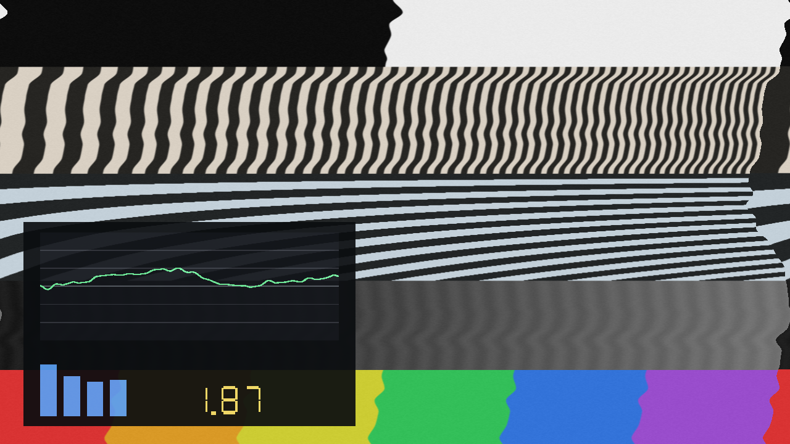

# Ferric user guide

Ferric puts the picture on tape: an FFGL plugin for [Resolume](https://resolume.com) Arena and
Avenue, and an OpenFX plugin for DaVinci Resolve, Vegas, Nuke and Natron, that treats the video
signal the way a cassette deck treats an audio one.

An unsteady transport drags the picture past the head so the image leans, waves and tears in
time; the oxide adds its own hiss and loses contact here and there; and the consumer sliding-band
noise reduction that hid one under the other is in there too, with **both ends of it under your
control**, which is where the interesting damage lives.

Two ideas hold it up, and they're worth ten seconds each because every control follows from one
of them.

**Wow and flutter is a timing error, and a picture read off tape is a signal with a clock.** Every
pixel gets a *tape time* (how far into the recording the head was when that pixel came off the
oxide) and one error signal is evaluated there. Nothing else. Wow is slower than a picture so the
whole frame leans; flutter fits a cycle or two into a picture so it draws a wave *down* the image,
and that wave scrolls between frames because the clock moved. Scrape flutter fits many cycles in
and becomes fine horizontal banding. Lines stretch as well as shift, because tape time varies
along the line too.

**Noise reduction is a round trip through a medium, not a filter.** Encoding boosts quiet
high-frequency detail before the tape so the tape's own noise sits underneath it; decoding cuts it
by the same amount afterwards and takes the hiss down with it. Nothing is removed. So the chain
here is the real chain, in the real order (encode, tape, decode), and **everything anybody
recognises about the format is the two ends disagreeing.**



*Default transport at a high Amount, with Show Trace on. The green plot is the error signal down
the picture, the same shape the image is being torn by, and the readout is weighted wow and
flutter as a percentage of a line period.*

> **Before you rely on this:** 34 automated checks pass from a clean universal build. The GLSL
> error signal agrees with an independent C++ implementation to 1.9e-05 over 6400 points, with a
> control case that must disagree. A neutral Ferric returns the picture **bit-exactly**, the
> compander moves vertical detail by 9.996 rms and horizontal detail by **0.000**, which is the
> whole one-dimensional claim, and encode into decode cancels to within 1.31 rms.
>
> **It's been loaded and rendered in Resolume Arena 7.27.1 on both macOS and Windows**, the
> Windows run on Mesa llvmpipe, a completely different GLSL compiler, which is what makes it worth
> doing. Both hosts read all 34 parameters correctly and both show the same weighted figure.
>
> Still open: **no operator has dragged a slider.** Every control was driven over Resolume's REST
> API, so the inspector's layout and feel are unjudged. **No NVIDIA or AMD driver has run it.**
> The OpenFX build, which v0.2.0 adds, renders the same pictures as the Resolume one to within one
> code value in 8 bits, checked pixel for pixel under a test host. It's been run in **DaVinci
> Resolve Studio 21.1 on macOS, as a Fusion tool**, where it matches that test host to within one
> code value too (a first try there failed; that's fixed). Vegas, Nuke and Natron have never
> opened it, and the Windows and Linux OpenFX builds have never rendered in a host. None of it has
> been through a show.
>
> This codebase was created with AI assistance, directed and reviewed by a human author.

---

## Installing

```
macOS    ~/Documents/Resolume Arena/Extra Effects/     (Ferric.bundle)
Windows  %USERPROFILE%\Documents\Resolume Arena\Extra Effects\   (Ferric.dll)
```

Avenue uses the same layout under its own folder name. There's also a macOS disk image and a
Windows installer, which put it there for you.

The macOS builds are **Developer ID-signed and notarised**, so there's nothing to clear. The
Windows builds are unsigned, but plugin files aren't gated the way `.exe` files are, so only the
installer trips SmartScreen, once.

Resolume scans the plugin folder at startup. If Ferric isn't in the effects list, restart it.

### OpenFX — Resolve, Vegas, Nuke, Natron

The OpenFX build ships from **v0.2.0**: each release carries `ferric-ofx-macos-universal.zip`,
`ferric-ofx-windows-x86_64.zip` and `ferric-ofx-linux-x86_64.zip`. Take the one for your platform
and copy `Ferric.ofx.bundle` into the standard OpenFX folder, then restart the host:

```
macOS    /Library/OFX/Plugins/
Windows  C:\Program Files\Common Files\OFX\Plugins\
Linux    /usr/OFX/Plugins/
```

It shows up as **Ferric** under **Stoatworks**. Everything in this guide applies to it, with five
differences:

- **There's no Reaction group.** OpenFX gives a plugin no audio and no tempo, so
  [Making it listen](#making-it-listen) is Resolume-only.
- **Beat Slip and Breathing aren't in its preset menu**, because they're built on the reaction.
- **Show Trace's meters always read zero**; the plot and the readout are the same.
- **Every frame is a function of its own time**, so scrubbing lands exactly where playing would.
  In Resolume the hiss and the dropouts advance with the frames actually rendered, so a stalled
  host doesn't make the grain jump; in an editor, which renders frames in any order, they follow
  the timeline.
- **Resolve's Fusion page reports the frame rate on the effect but not on its clips; the plugin
  reads the effect's, and assumes 24 fps only where a host reports none.** So in Fusion, as on the
  Edit page, wow, flutter, drift and the moving hiss and dropouts follow the timeline's real rate.

The OpenFX build renders on the CPU, so it's far slower than the GPU in Resolume (see
[Cost](#cost)).

---

## Start here: Tape Speed is the control that matters

Everything else is a depth. **Tape Speed decides how much of the error signal fits inside one
picture**, and it's what moves the effect between "the frame is leaning" and "the image has come
apart into ribbons".

There's a fiction underneath it, and it's out in the open. A real 625-line picture scans at 15625
lines per second, and at that rate audio-band flutter is a *constant* across the whole frame: no
vertical structure, no wave, no tearing at all. Audio wow and flutter and video time-base error
just aren't the same phenomenon. So Ferric does what it says on the tin instead and runs a picture
through a **cassette transport**, and a cassette transport doesn't scan at 15625 lines a second.
Tape Speed is that fiction, exposed, from about two milliseconds of tape per picture to about two
seconds.

Fast end, the frame is rigid and only wow survives. Middle, one or two flutter cycles fit down the
picture and it looks like a tape. Slow end, a single cycle spans a few scanlines and it falls
apart.

**Turn on Show Trace while you set it.** The plot's horizontal axis is position down the picture,
so the number of humps on the graticule is the number of waves in the image. It's the quickest way
to land the look you want, and the meters underneath answer "is it hearing anything?" without
leaving Resolume.

---

## The transport

**Machine** multiplies your controls rather than replacing them, and sets the *character*:

- **Cassette:** wow dominates, soft flutter, scrape from the felt pressure pad.
- **Reel to Reel:** everything an order better, and what flutter is left runs faster.
- **Video Head:** dominated by a once-per-revolution component, so far more periodic than either
  tape machine.
- **Failing:** a slipping belt or a flat spot on an idler. Deep wow with a hard lurch on it. This
  one has given up on meeting a specification.

**Wow** (slow, leans the frame), **Flutter** (fits cycles into the picture; this is the one that
makes it look like the thing the plugin is named after), **Scrape** (fine horizontal banding) and
**Drift** (a slow random walk over seconds) are the four components. **Amount** scales all of
them; **Vertical** decides how much of the *slow* part also rolls the frame, because a sync
separator has a time constant and never sees flutter.

---

## The tape

**Hiss** isn't decoration and it isn't zero by default. Noise reduction with no noise to reduce
is an identity function with extra steps: the decode stage would have nothing to show for itself
and half the plugin would look broken. The hiss is generated along the scan, one-dimensionally, so
it comes out as horizontal grain rather than film-style speckle. That's what video noise looks
like.

**Dropouts** are the oxide losing contact with the head: a run of a scanline going bright, tapered
at both ends. **Head Wear** takes high frequencies off along the scan and widens the hiss with it.

---

## Noise reduction: the good half

**NR Type** picks the curve: **Type B** (one band, forgiving) or **Type C** (two bands, an order
quieter and far less forgiving). These are the well-known consumer sliding-band systems; they're
somebody's trademark and this isn't their product, so they're called by the names the rest of the
industry uses.

**NR Mode** is where the interesting damage is:

| | What it sounds like, as a picture |
| --- | --- |
| **Encode + Decode** | The honest chain. Nearly transparent with the levels matched — and that is the point, because then the effect is what the *tape* did. |
| **Decode Only** | As if the source had never been encoded. Dull, breathing, detail sucked out of the quiet parts. The most recognisable of the three. |
| **Encode Only** | As if nothing ever decoded it. Hard, glassy, edges screaming. |

**Mistracking** is the control most worth reaching for. It's the decoder's level error in dB,
centred at correct. Push it either way and the round trip cancels at some brightnesses and not
others, so detail *pumps* as the shot changes: a tape recorded on one deck and played on another.
Type C mistracks visibly by 4 dB where Type B shrugs it off, which is the reputation the real ones
have too.

**The processing is one-dimensional and horizontal**, because tape has one frequency axis and it
lands on the picture as the scan direction. Vertical edges pump; horizontal ones sit perfectly
still. That asymmetry is the effect rather than a shortcut, and it's measured: 9.996 against
0.000.

---

## Making it listen

*Resolume only: the OpenFX build has no audio input and no Reaction group.*

**Every reaction control is off by default.** Dropped on a layer with nothing routed, this is an
ordinary manual tape emulation and behaves like one.

There are three ways in, and they stack:

| | What it does |
| --- | --- |
| **Beat Depth** | Puts a sharp, decaying excursion straight into the error signal on the grid — the belt slipping. Not a modulation of something already running; a discontinuity. Only the second of those reads as mechanical. |
| **Level Depth** | Hands the transport's own wow and flutter over to the music, so quiet passages run clean and loud ones fall apart. |
| **Band Depth** | Pushes the decoder off level with band energy, so the noise reduction breathes with the mix. Routed to treble by default, because that is what a sliding band is looking at. |

**Route** decides which band drives which. Natural gives the transport bass and the decoder
treble, so both halves of the plugin are doing something at once, and it's the one worth starting
from. Depth is carved out of the setting rather than added on top, so at full Level Depth silence
renders clean and a loud passage renders what you dialled in.

---

## Presets

Nine of them, and seven leave every reactive depth at zero so a preset picked with nothing routed
still behaves. The two that don't have it in their names, and are Resolume-only: the OpenFX menu
offers the other seven.

**Clean Deck** · **Compact Cassette** · **Chewed Tape** · **Undecoded** · **Wrong Deck** ·
**Head Clog** · **Ribbons** · **Beat Slip** · **Breathing**

Editing any control a preset covers drops the dropdown back to Custom and keeps your edit.

---

## If it looks wrong

**Nothing is happening.** Amount is at zero, or Mix is. Turn on **Show Trace**: if the green plot
is a flat line through the middle, the transport really is still.

**It slides sideways but never tears.** Tape Speed is too fast, so the whole error signal is
nearly constant across one picture. Slow it down and watch the humps appear on the trace.

**It tears but there's no wave down the picture.** You're leaning on Wow and Drift, which are
slower than a frame. Flutter is the one that fits cycles into a picture.

**The noise reduction does nothing.** Check **NR Mode**. On Encode + Decode with Mistracking
centred it's *supposed* to be nearly transparent, because the two ends cancel. Try Decode Only,
or move Mistracking off centre.

**Turning the noise reduction on made no difference to the hiss.** You're on Encode Only. The
encoder runs *before* the tape, so it can't touch a noise floor that doesn't exist yet. That's
the pass order being right, not a bug.

**The whole picture went dull.** Decode Only, or Mistracking pulled well negative. That's the
effect.

**It reads as a detail sharpener rather than tape.** Look at a horizontal edge: it should be
completely untouched while vertical ones move. If both are moving, something's wrong and it's
worth reporting.

---

## Cost

Measured on an M4 Max: **0.34 ms/frame at 1080p and 0.70 ms at 4K**, with Type C and dropouts both
running. The compander is the expensive part and it costs the same whichever type is selected.

The OpenFX build does the same work on the CPU: about **30 ms/frame at 1080p and 140 ms at 4K** on
8 threads of the same machine (15 ms at 1080p at the defaults), and roughly eight times that on
one.
